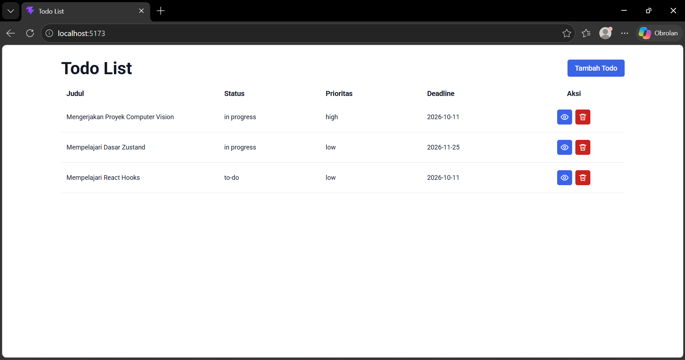
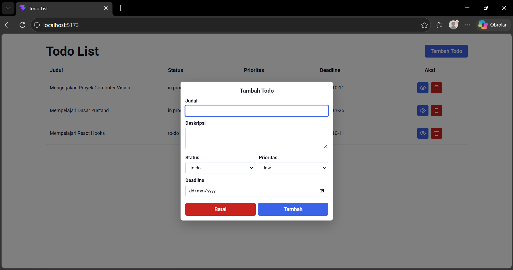
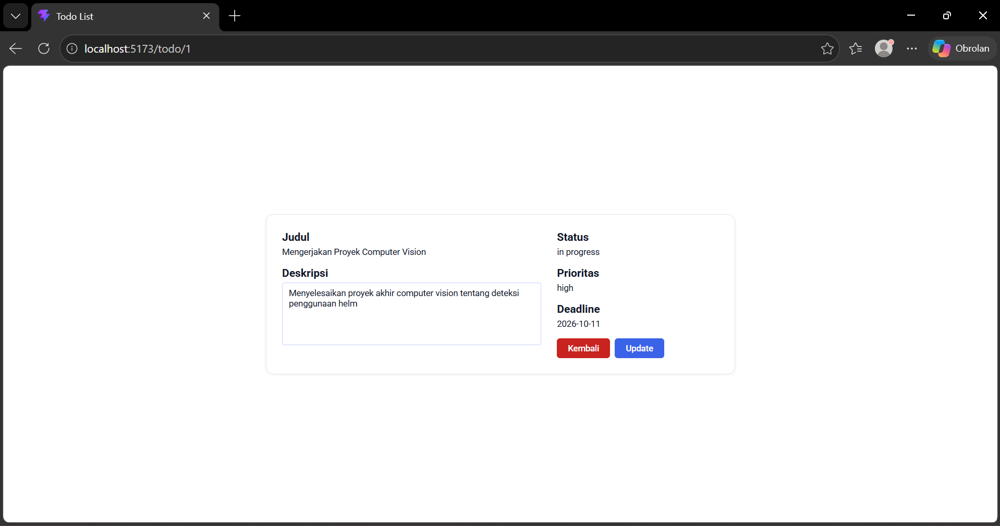
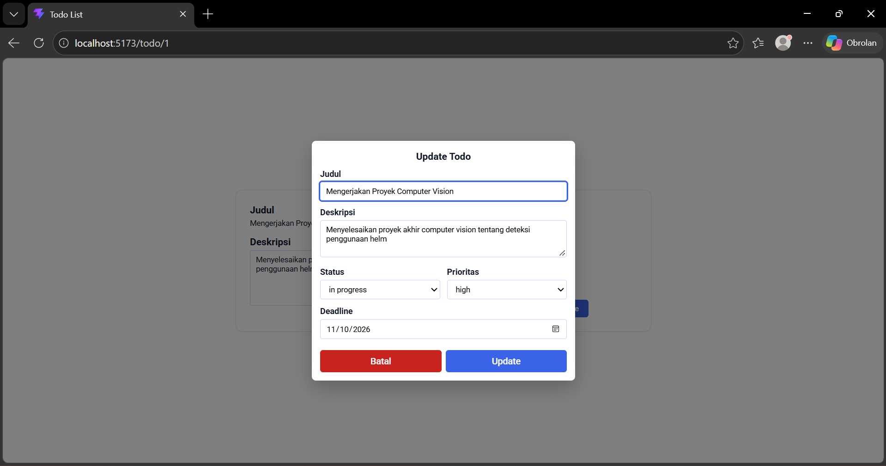
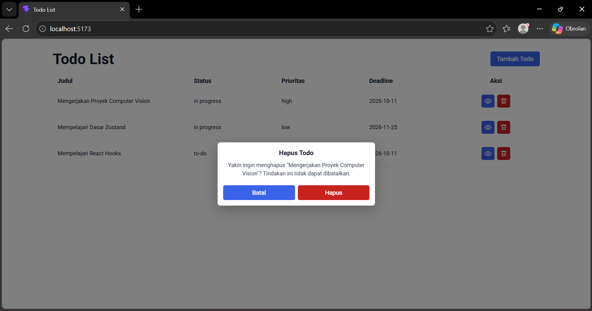

# Todo List — React.js
Aplikasi To-Do List frontend (React + Vite) untuk Kuis Praktikum. Data memakai dummy dan state React.

## Fitur
- Menampilkan daftar tugas
- Melihat detail tugas (`/todo/:id`)
- Menambah tugas lewat modal form
- Memperbarui tugas lewat modal form
- Menghapus tugas dengan konfirmasi
- Notifikasi (toast) setelah tambah, update, dan hapus
- Validasi form (judul dan deadline wajib diisi)

## Struktur data
`id`, `title`, `description`, `priority`, `deadline`, `status`

## Menjalankan
```bash
npm install
npm run dev
```
Buka http://localhost:5173

## Screenshot
### Daftar Todo

### Tambah Todo

### Detail Todo

### Update Todo

### Konfirmasi Hapus

